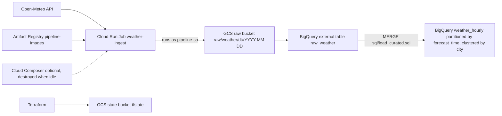

# gcp-terraform-foundation

Terraform for a small GCP data platform: weather ingestion into Cloud Storage, raw and curated tables in BigQuery, and an optional Composer environment for orchestration.

- Project: de-project-512112
- Region: asia-south1
- State: GCS remote backend (bucket de-project-512112-tfstate, prefix foundation/state, versioned)

## Architecture



## Layout

| Path | Purpose |
|---|---|
| main.tf, variables.tf, outputs.tf | Provider, backend, shared locals and outputs |
| apis.tf | Enables required APIs with for_each (disable_on_destroy = false) |
| pipeline.tf | Raw bucket, pipeline-sa, objectCreator binding, Artifact Registry repo |
| cloudrun.tf | Cloud Run Job weather-ingest (runs as pipeline-sa, image pinned to a tag) |
| bigquery.tf | External raw table and curated weather_hourly table |
| composer.tf | Composer 3 (small) with its service account and IAM; costs money while it exists |
| modules/data-lake | Reusable bucket and BigQuery dataset |
| sql/load_curated.sql | Idempotent MERGE from raw to curated |
| dags/hello_dag.py | Sample Airflow DAG |
| .github/workflows/terraform.yml | CI: fmt -check, init -backend=false, validate |

## Usage

```
terraform init
terraform fmt -check
terraform validate
terraform plan
terraform apply
```

Read the destroy count in every plan before applying. See the Makefile for shortcuts and copy terraform.tfvars.example to terraform.tfvars for local values.

## Operating notes

- Composer takes about 19 minutes to create and bills while it exists. Destroy it after each session, then check: gcloud composer environments list --locations=asia-south1, gcloud storage ls, bq ls. The leftover Composer bucket must be deleted manually.
- Run plan only on the branch or main whose code matches the state. Merge the PR before planning on main.
- terraform apply -target is for recovery only; it hides drift and pending changes.
- The Cloud Run image is built from the pipeline-container repo and pinned by tag (for example v1) for reproducible deploys.

## Roadmap

- enable_composer variable so Composer is optional
- CI plan job using Workload Identity Federation
- Cloud Scheduler or Composer trigger for weather-ingest
- Dataflow transform and data quality checks
